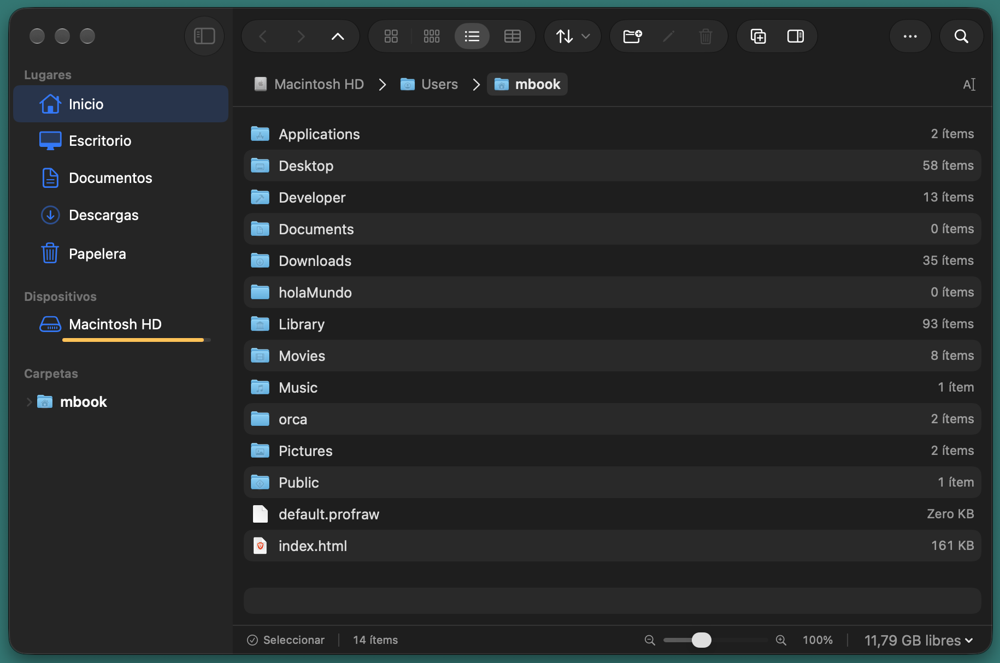

<p align="center">
  
</p>

<h1 align="center">Dotphin</h1>

<p align="center">A native macOS file manager, built with SwiftUI, that brings KDE Dolphin's file-exploration workflow to the Mac.</p>

<p align="center">
  
</p>

## What it is

Dotphin is a from-scratch macOS file manager inspired by [KDE Dolphin](https://apps.kde.org/dolphin/)'s feature set, restyled to Apple's Human Interface Guidelines and Liquid Glass rather than cloned pixel-for-pixel. It does not share code with Dolphin — only the UX ideas it's worth porting.

## Features

- Tabs and split-pane browsing, with drag & drop between panes and with Finder
- Places sidebar (local/USB volumes) and a navigable folder tree
- Icon, compact, and details view modes with per-folder view properties (sort, group, zoom)
- Breadcrumb navigation and a filter/search bar (filename, content, size, type)
- Git status overlays on files and folders in a repo
- File operations: copy/move/rename, batch rename, undo/redo, archives (zip), file compare
- Info panel with Quick Look thumbnails and rich metadata
- Trash as a navigable location, with external volume eject support
- Embedded terminal panel synced to the active folder
- Configurable toolbar and a Settings window (default view, startup location, hidden files)

## Requirements

- macOS 27 or later
- Xcode 27 / Swift 6.4 toolchain

## Build & run

```sh
swift run
```

Or open `Package.swift` directly in Xcode and hit Run.

## Tests

```sh
swift test
```

## Project layout

Pure Swift Package Manager, no `.xcodeproj` checked in:

```
Sources/Dotphin/
  App/        # app entry point, menu commands
  Models/     # value types (FileItem, AppSettings, ViewProperties, ...)
  Services/   # file system, git, search, archive, settings persistence, ...
  ViewModels/ # BrowserViewModel, TabsViewModel
  Views/      # SwiftUI views
Tests/DotphinTests/
```
